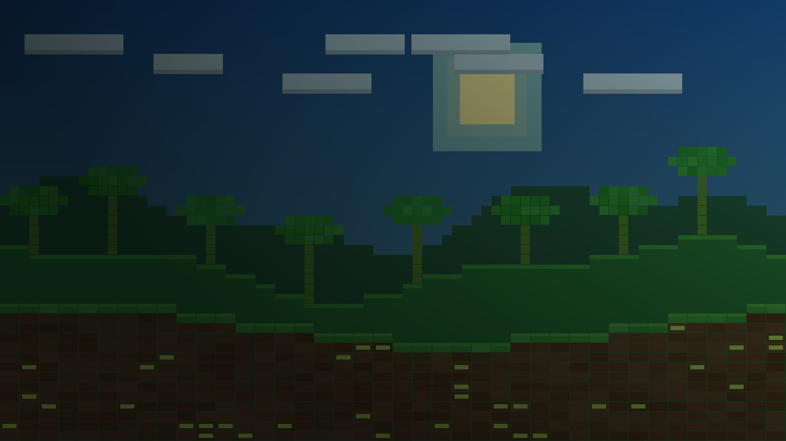
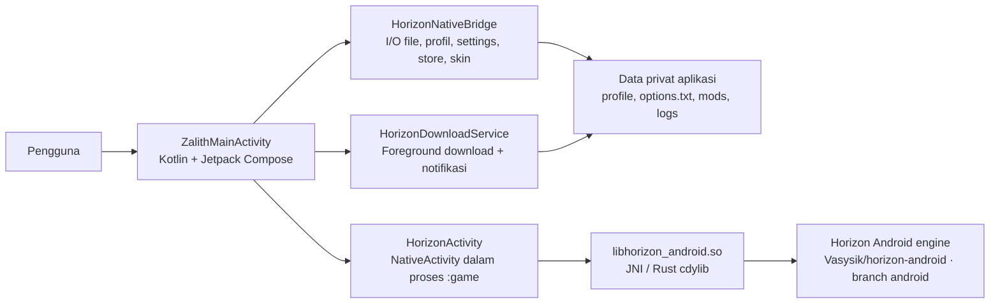

<!-- HORIZONZ_README_PRESERVE -->
<p align="center">
  
</p>

<h1 align="center">HorizonZ Launcher</h1>
<p align="center"><strong>Minecraft Java Edition di Android — launcher Kotlin, runtime native Rust.</strong></p>
<p align="center">
  <a href="https://github.com/Fadiba21/Horizonz-Launcher/actions/workflows/build-apk.yml"></a>
  
  
</p>

<!-- HORIZONZ_VERSION_START -->
<p align="center">
  <a href="https://github.com/Fadiba21/Horizonz-Launcher/releases/latest"></a>
  <strong>Source saat ini:</strong> <code>1.19.0-HorizonZ</code> · <strong>versionCode:</strong> <code>43</code> · <strong>minimum Android:</strong> API 28 · <strong>compile/target SDK:</strong> 35/35
</p>
<!-- HORIZONZ_VERSION_END -->

> **Catatan visual:** hero art di atas memakai wallpaper pixel bawaan source Archive v1.19 (`mc_wall_11.jpg`). Ini adalah aset wallpaper dashboard, **bukan screenshot UI launcher**. Screenshot UI autentik belum tersedia pada source yang dipilih.

## 🧭 Isi README

- [Apa itu HorizonZ](#-apa-itu-horizonz)
- [Fitur utama](#-fitur-utama)
- [Ringkasan perubahan terbaru](#-ringkasan-perubahan-terbaru)
- [Cara kerja dan arsitektur](#-cara-kerja-dan-arsitektur)
- [Spesifikasi teknis](#-spesifikasi-teknis)
- [Build dan rilis](#-build-dan-rilis)
- [Peta source](#-peta-source)
- [Kebijakan update ZIP dan README](#-kebijakan-update-zip-dan-readme)

## 🎮 Apa itu HorizonZ?

HorizonZ adalah launcher Android untuk menjalankan **Minecraft: Java Edition** melalui runtime native Horizon. Source v1.19 menggabungkan antarmuka Android berbasis Kotlin/Jetpack Compose dengan engine Rust yang dipaketkan sebagai library JNI. Aplikasi menyediakan dashboard, pengelolaan versi dan aset, katalog konten, file, akun/skin, log, serta pengaturan; proses game berjalan terpisah dari launcher.

Source Archive v1.19 menargetkan runtime Minecraft Java Edition 26.3. HorizonZ adalah proyek komunitas dan **tidak berafiliasi dengan Mojang atau Microsoft**.

## ✨ Fitur utama

| Area | Yang tersedia di source v1.19 |
|---|---|
| 🏠 **Dashboard** | Carousel wallpaper, splash text, dan impor wallpaper pilihan pengguna. Source CI dapat menyiapkan hingga 18 wallpaper 16:9 berukuran 1280 × 720. |
| ⬇️ **Game & Assets** | Layar versi game/aset, unduhan yang dapat berjalan di latar belakang, notifikasi Android dengan tahap, persentase, kecepatan dan URL, serta aksi jeda, lanjutkan dan batalkan. |
| 🧩 **Store & Mods** | Kategori Mods, Native Mods, Modpacks, Resource Packs, dan Shader Packs; status instalasi/pembaruan, versi rilis, serta pengelolaan konten per folder. |
| 📁 **Files** | Akses file dan impor/ekspor melalui Android Storage Access Framework dan document provider aplikasi. |
| 👤 **Accounts & Skins** | Profil dan pengelolaan skin; bridge dapat menormalkan skin Minecraft 64×64, mengenali model lengan slim/standard, dan menyinkronkan skin aktif ke runtime. |
| ⚙️ **Settings** | Sinkronisasi pengaturan launcher/runtime dan dua arah `options.txt` untuk opsi yang didukung, termasuk Render Distance, Simulation Distance, Max FPS, GUI Scale, VSync, dan Fullscreen. `horizon-keypad.json` menyimpan konfigurasi kontrol sentuh. |
| 🧾 **System Logs** | Log lintas proses dan fitur clear log; tersedia pula ekspor laporan performa dan perbaikan aset. |
| 🎮 **Gameplay** | NativeActivity layar penuh landscape, immersive mode, kontrol sentuh, serta pengembalian ke launcher saat game ditutup. |

Navigasi utama di UI: **Dashboard**, **Game & Assets**, **Store**, **Files & Mods**, **Account & Skins**, **System Logs**, dan **Settings**.

## 🆕 Ringkasan perubahan terbaru

<!-- HORIZONZ_UPDATE_SUMMARY_START -->
**v1.19.0-HorizonZ — ringkasan source Archive.**

- **Touch controls:** CI memaketkan 60 tekstur kontrol Bedrock ke `engine-data.zip`; patch runtime menambah batas waktu, mirror CDN cadangan, dan fallback PNG untuk menghindari proses yang macet pada tahap `5/6` atau `17/60`.
- **Unduhan latar belakang:** `HorizonDownloadService` memakai foreground service `dataSync` agar unduhan tetap berjalan saat launcher diminimalkan dan menampilkan notifikasi progres langsung.
- **Sinkronisasi pengaturan:** penyelarasan `horizon-keypad.json` dan sinkronisasi dua arah `options.txt` dengan runtime.
- **Keluar dari game:** token peluncuran, flag keluar, dan watchdog di proses `:game` membantu menutup game dengan bersih dan kembali ke launcher.
- **Build Rust:** perbaikan penempatan komentar dokumentasi Rust dan konfigurasi fitur audio untuk ABI `armeabi-v7a`.
<!-- HORIZONZ_UPDATE_SUMMARY_END -->

## 🧱 Cara kerja dan arsitektur



**Alur sederhananya:** Compose menampilkan UI dan menangani navigasi. `HorizonNativeBridge.kt` menghubungkan layar ke data profil, file game, katalog, skin, log, dan engine. `HorizonDownloadService.kt` mengerjakan unduhan sebagai foreground service. Saat pengguna menekan Play, `HorizonActivity` membuka `NativeActivity` di proses Android terpisah (`:game`), memuat `libhorizon_android.so`, menyiapkan `HORIZON_HOME`, lalu menjalankan runtime Rust.

Engine Android tidak seluruhnya tersimpan sebagai source di repo ini. Workflow rilis mengambil workspace publik [`Vasysik/horizon-android`](https://github.com/Vasysik/horizon-android) pada branch `android`, menerapkan patch HorizonZ, lalu membangun library native untuk Android.

## ⚙️ Spesifikasi teknis

| Komponen | Nilai v1.19 |
|---|---|
| Application ID | `dev.horizon.android` |
| `versionName` / `versionCode` | `1.19.0-HorizonZ` / `43` |
| Minimum Android | API 28 (Android 9) |
| Compile / target SDK | API 35 / API 35 |
| ABI APK | `arm64-v8a` dan `armeabi-v7a` |
| UI Android | Kotlin 2.0.21, Jetpack Compose, Android Gradle Plugin 8.7.3 |
| Native layer | Rust `cdylib` + JNI; engine workspace disiapkan CI |
| Build tools rilis | JDK 17, Android NDK 28.2.13676358, Gradle 8.10.2 |
| Grafik/perangkat | OpenGL ES 3.0 wajib; Vulkan level 1 opsional; layar sentuh dan gamepad opsional menurut manifest |
| Orientasi | Launcher dan game menggunakan landscape/sensor landscape |

## 🛠️ Build dan rilis

### Unduh APK

Buka [GitHub Releases](https://github.com/Fadiba21/Horizonz-Launcher/releases/latest), lalu pilih APK sesuai arsitektur perangkat: `arm64-v8a` untuk kebanyakan ponsel Android modern atau `armeabi-v7a` untuk perangkat 32-bit. Release menyertakan `SHA256SUMS.txt` untuk pemeriksaan integritas.

### Build source

Build rilis lengkap didefinisikan di [`.github/workflows/build-apk.yml`](.github/workflows/build-apk.yml). Workflow menyiapkan JDK 17, Android platform/build-tools 35, NDK, Rust target Android, mengambil workspace engine dan menerapkan patch, menyiapkan tekstur kontrol/wallpaper, lalu menjalankan Gradle untuk membuat APK kedua ABI. Workflow juga mengunggah APK dan checksum ke GitHub Release.

`tools/android_build.py` adalah helper untuk workspace yang sudah disiapkan. Untuk hasil yang sama dengan release, gunakan workflow karena tahap clone engine dan patch dilakukan di sana. Contoh perintah helper setelah dependensi dan workspace native tersedia:

```bash
python3 tools/android_build.py --abi arm64-v8a --profile release --public
```

## 🗂️ Peta source

| Path | Isi |
|---|---|
| `packaging/android/java/.../ui/` | Layar launcher Compose dan tema |
| `packaging/android/java/.../bridge/` | Bridge Kotlin untuk file, profil, download, store, skin, settings, dan log |
| `packaging/android/java/.../service/` | Foreground download service |
| `packaging/android/java/dev/horizon/android/HorizonActivity.java` | NativeActivity game, environment runtime, splash, dan exit watchdog |
| `crates/horizon-android/` | Rust JNI/cdylib Android yang digunakan saat build |
| `packaging/android/res/drawable-nodpi/` | Wallpaper pixel bawaan dan aset aplikasi |
| `scripts/patch_horizon_direct_boot.py` | Patch source engine yang disiapkan workflow |
| `scripts/prestage_controls_and_wallpapers.py` | Menyiapkan tekstur kontrol dan wallpaper untuk paket rilis |
| `scripts/apply_update_zip.py` | Mengaplikasikan source ZIP dari `Update/` dengan proteksi README |
| `tools/android_build.py` | Helper build Rust/Gradle |
| `.github/workflows/build-apk.yml` | Pipeline build dan publikasi APK |

## ♻️ Kebijakan update ZIP dan README

Source ZIP yang memang dipilih untuk update ditempatkan di `Update/` dan diproses oleh workflow build. **Jangan sertakan ZIP v1.20 yang pernah ditemukan di fork; basis repo ini adalah Archive v1.19.** Folder `Update/` pada source ini hanya memiliki `.gitkeep` dan panduan, bukan ZIP update.

README ini ditandai `<!-- HORIZONZ_README_PRESERVE -->`. `scripts/apply_update_zip.py` menjaga layout dan isi README: versi pada blok `HORIZONZ_VERSION` diperbarui dari `versionName`/`versionCode` dalam `packaging/android/build.gradle`, sedangkan ringkasan perubahan hanya diganti jika README dari ZIP baru menyertakan blok `HORIZONZ_UPDATE_SUMMARY_START` dan `HORIZONZ_UPDATE_SUMMARY_END`. Bila blok ringkasan tidak ada, catatan lama dipertahankan dan workflow memberi peringatan—tidak menebak fitur baru dari perubahan kode.

Saat menyiapkan ZIP source berikutnya, pertahankan seluruh README ini dan edit **hanya** ringkasan di antara marker `HORIZONZ_UPDATE_SUMMARY_START` / `HORIZONZ_UPDATE_SUMMARY_END` sesuai perubahan nyata. Dengan begitu identitas proyek, arsitektur, panduan, dan tata letak tetap utuh; nomor versi mengikuti Gradle, sementara changelog mengikuti konteks update.

Jika minimum Android, SDK, ABI, build tools, atau arsitektur runtime berubah, perbarui baris spesifikasi dan bagian teknis terkait secara eksplisit. Updater otomatis hanya menyentuh blok versi dan ringkasan yang bertanda; ia tidak menebak perubahan teknis dari diff kode.

## 📜 Lisensi dan atribusi

Lihat [`LICENSE.txt`](LICENSE.txt) dan [`THIRD_PARTY_NOTICES.md`](THIRD_PARTY_NOTICES.md) untuk lisensi source serta komponen pihak ketiga. Minecraft adalah merek dagang Mojang/Microsoft; HorizonZ bukan produk resmi atau afiliasinya.
