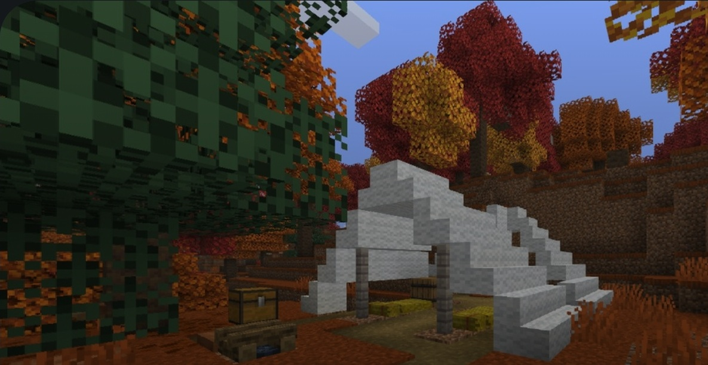
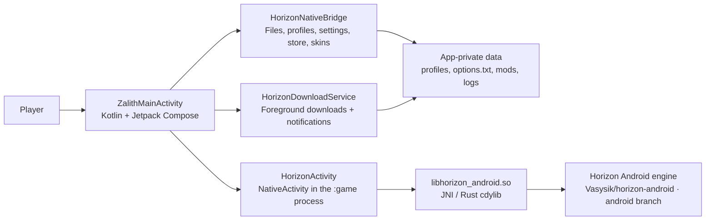
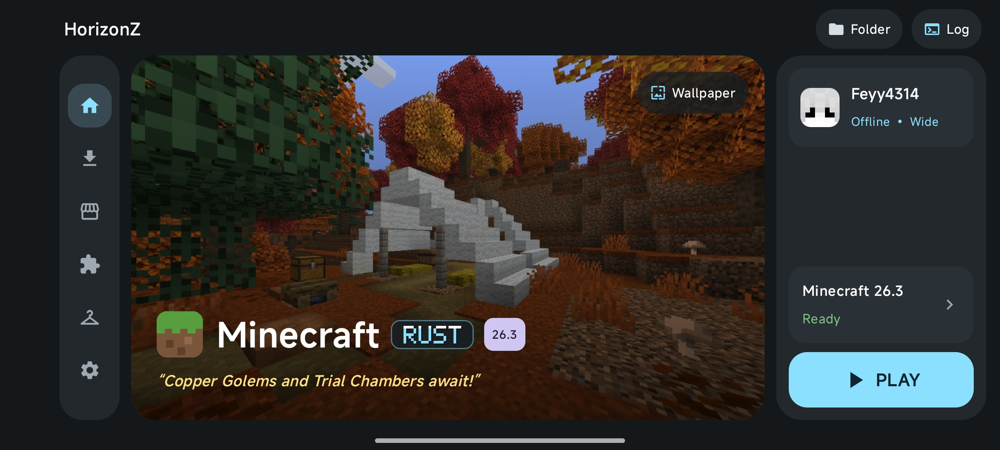
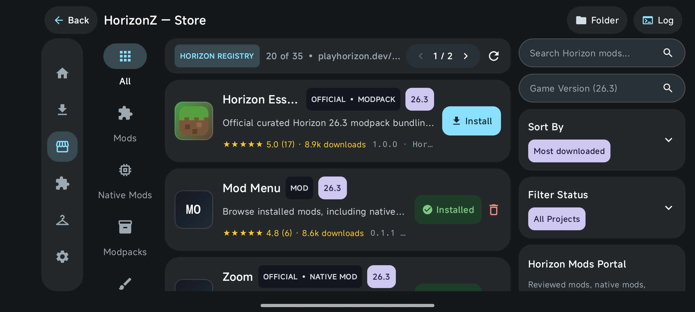
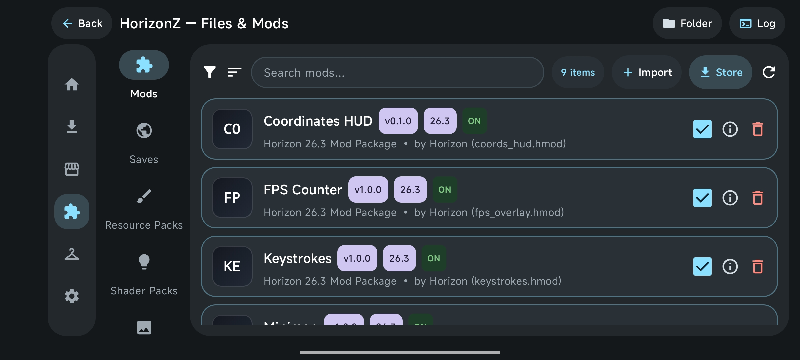
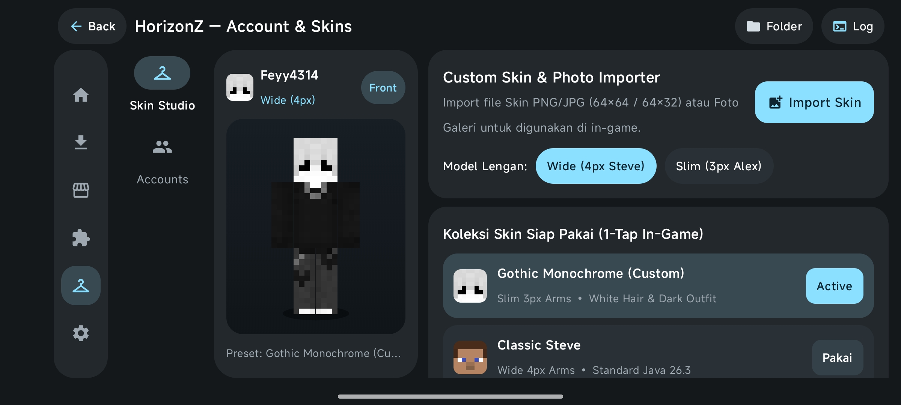
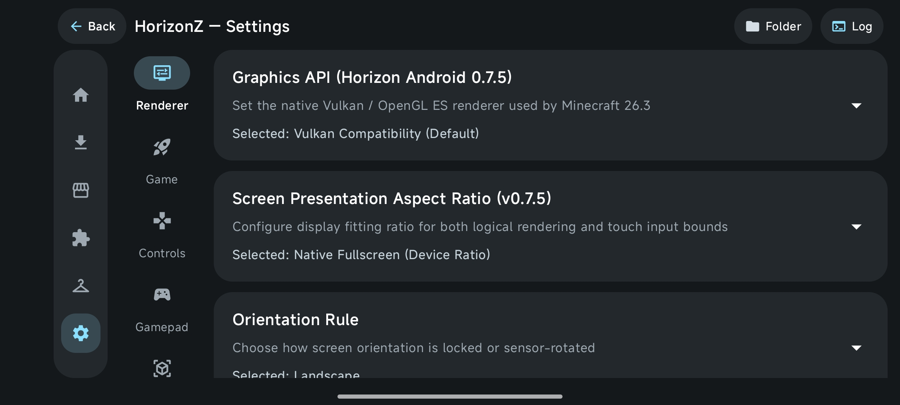

<!-- HORIZONZ_README_PRESERVE -->
<!-- HORIZONZ_README_LANGUAGE: en -->
<p align="center">
  
</p>

<h1 align="center">HorizonZ Launcher</h1>
<p align="center"><strong>Minecraft: Java Edition on Android — Kotlin launcher, native Rust runtime.</strong></p>
<p align="center">
  <a href="https://github.com/Fadiba21/Horizonz-Launcher/actions/workflows/build-apk.yml"></a>
  
  
</p>

<!-- HORIZONZ_VERSION_START -->
<p align="center">
  <a href="https://github.com/Fadiba21/Horizonz-Launcher/releases/latest"></a>
  <strong>Current source:</strong> <code>1.19.0-HorizonZ</code> · <strong>versionCode:</strong> <code>43</code> · <strong>Minimum Android:</strong> API 28 · <strong>Compile/target SDK:</strong> 35/35
</p>
<!-- HORIZONZ_VERSION_END -->

> **Banner provenance:** this is a clean crop from the authentic Minecraft landscape shown in the supplied HorizonZ Home screenshot. It contains no generated or stock imagery; the complete original screenshot is included below.

## 📘 Contents

- [About HorizonZ](#-about-horizonz)
- [Features](#-features)
- [Latest source update](#-latest-source-update)
- [How it works](#-how-it-works)
- [Technical specifications](#-technical-specifications)
- [Build and downloads](#-build-and-downloads)
- [Authentic launcher screenshots](#-authentic-launcher-screenshots)
- [Source map](#-source-map)
- [ZIP updates and README language](#-zip-updates-and-readme-language)
- [License and attribution](#-license-and-attribution)

## 🎮 About HorizonZ

HorizonZ is an Android launcher for **Minecraft: Java Edition**, powered by the native Horizon runtime. Archive v1.19 combines a Kotlin/Jetpack Compose Android interface with a Rust engine packaged as a JNI library. The app provides a dashboard, game-version and asset management, a content catalog, file access, accounts and skins, logs, and settings. The game runs in a separate Android process from the launcher.

This source targets Minecraft Java Edition 26.3. HorizonZ is a community project and **is not affiliated with Mojang or Microsoft**.

## ✨ Features

| Area | What Archive v1.19 contains |
|---|---|
| 🏠 **Home dashboard** | Wallpaper carousel, splash text, and user wallpaper import. CI can prepare up to 18 widescreen 1280 × 720 backgrounds. |
| ⬇️ **Game and assets** | Game-version and asset screens; background downloads with Android progress notifications showing stage, percentage, speed, and URL; pause, resume, and cancel actions. |
| 🧩 **Store and mods** | Mods, Native Mods, Modpacks, Resource Packs, and Shader Packs; installation/update state, release versions, and per-folder content management. |
| 📁 **Files** | File access and import/export through Android's Storage Access Framework and the app's document provider. |
| 👤 **Accounts and skins** | Profile and skin management; the bridge normalizes 64×64 Minecraft skins, detects slim/standard arm models, and syncs the active skin to the runtime. |
| ⚙️ **Settings** | Launcher/runtime settings sync and two-way `options.txt` sync for supported options such as Render Distance, Simulation Distance, Max FPS, GUI Scale, VSync, and Fullscreen. `horizon-keypad.json` stores touch-control settings. |
| 🧾 **System logs** | Cross-process logs and log clearing, plus performance-report export and asset repair actions. |
| 🎮 **Gameplay** | Full-screen landscape `NativeActivity`, immersive mode, touch controls, and a return to the launcher when the game exits. |

The main navigation includes **Home**, **Game & Assets**, **Store**, **Files & Mods**, **Account & Skins**, **System Logs**, and **Settings**.

## 🆕 Latest source update

<!-- HORIZONZ_UPDATE_SUMMARY_START -->
<!-- HORIZONZ_UPDATE_SUMMARY_LANGUAGE: en -->
**v1.19.0-HorizonZ — Archive source highlights.**

- **Touch controls:** CI bundles 60 Bedrock control textures into `engine-data.zip`. Runtime patches add timeouts, CDN mirrors, and a PNG fallback to prevent stalls at `5/6` or `17/60`.
- **Background downloads:** `HorizonDownloadService` uses an Android `dataSync` foreground service so downloads continue when the launcher is minimized, with live progress notifications.
- **Settings sync:** synchronizes `horizon-keypad.json` and supported `options.txt` settings in both directions.
- **Clean game exit:** a launch token, exit flag, and watchdog in the `:game` process help close the game cleanly and return to the launcher.
- **Rust build fixes:** corrects Rust documentation-comment placement and configures audio features for the `armeabi-v7a` ABI.
<!-- HORIZONZ_UPDATE_SUMMARY_END -->

## 🧱 How it works



Jetpack Compose renders the screens and handles navigation. `HorizonNativeBridge.kt` connects the UI to profiles, game files, the catalog, skins, logs, and the runtime. `HorizonDownloadService.kt` handles downloads as an Android foreground service. When the player taps **Play**, `HorizonActivity` launches `NativeActivity` in the separate `:game` process, loads `libhorizon_android.so`, prepares `HORIZON_HOME`, and starts the Rust runtime.

The engine workspace is not fully stored in this repository. The release workflow checks out the public [`Vasysik/horizon-android`](https://github.com/Vasysik/horizon-android) project on its `android` branch, applies HorizonZ patches, and builds the Android native library.

## ⚙️ Technical specifications

| Component | Archive v1.19 value |
|---|---|
| Application ID | `dev.horizon.android` |
| `versionName` / `versionCode` | `1.19.0-HorizonZ` / `43` |
| Minimum Android | API 28 (Android 9) |
| Compile / target SDK | API 35 / API 35 |
| APK ABIs | `arm64-v8a` and `armeabi-v7a` |
| Android UI | Kotlin 2.0.21, Jetpack Compose, Android Gradle Plugin 8.7.3 |
| Native layer | Rust `cdylib` + JNI; engine workspace prepared by CI |
| Release build tools | JDK 17, Android NDK 28.2.13676358, Gradle 8.10.2 |
| Graphics/device requirements | OpenGL ES 3.0 required; Vulkan 1 optional; touch screen and gamepad are optional in the manifest |
| Orientation | Launcher and game use landscape/sensor-landscape orientation |

## 🛠️ Build and downloads

### Download an APK

Open [GitHub Releases](https://github.com/Fadiba21/Horizonz-Launcher/releases/latest) and choose the APK for the device architecture: `arm64-v8a` for most modern Android phones or `armeabi-v7a` for 32-bit devices. Releases include `SHA256SUMS.txt` for integrity checks.

### Build from source

The complete release build is defined in [`.github/workflows/build-apk.yml`](.github/workflows/build-apk.yml). It sets up JDK 17, Android platform/build-tools 35, the NDK, and Android Rust targets; fetches the engine workspace and applies patches; prepares control textures and wallpapers; builds both ABI variants; and uploads the APKs and checksums to a GitHub Release.

`tools/android_build.py` is a helper for an already prepared workspace. For a release-equivalent build, use GitHub Actions because that workflow also prepares the engine checkout and patches. Example helper command after the required native workspace and dependencies are available:

```bash
python3 tools/android_build.py --abi arm64-v8a --profile release --public
```

## 📸 Authentic launcher screenshots

These are the original HorizonZ launcher screenshots supplied for this README. They are kept unedited; the banner above is a crop from the Home screenshot.

### 🏠 Home



### 🛍️ Store



### 🧩 Files and Mods



### 👤 Account and Skins



### ⚙️ Settings



## 🗂️ Source map

| Path | Purpose |
|---|---|
| `packaging/android/java/.../ui/` | Compose launcher screens and theme |
| `packaging/android/java/.../bridge/` | Kotlin bridges for files, profiles, downloads, store, skins, settings, and logs |
| `packaging/android/java/.../service/` | Foreground download service |
| `packaging/android/java/dev/horizon/android/HorizonActivity.java` | Game `NativeActivity`, runtime environment, splash, and exit watchdog |
| `crates/horizon-android/` | Rust JNI/cdylib Android library used by the build |
| `packaging/android/res/drawable-nodpi/` | Bundled pixel wallpapers and app assets |
| `docs/images/` | Authentic gameplay banner crop from the supplied Home screenshot |
| `docs/screenshots/` | Original launcher screenshots supplied for the README |
| `scripts/patch_horizon_direct_boot.py` | Patch applied to the engine workspace by CI |
| `scripts/prestage_controls_and_wallpapers.py` | Prepares touch-control textures and release wallpapers |
| `scripts/apply_update_zip.py` | Applies a source ZIP from `Update/` while protecting README layout/language |
| `tools/android_build.py` | Rust/Gradle build helper |
| `.github/workflows/build-apk.yml` | APK build and release pipeline |

## ♻️ ZIP updates and README language

This branch is based on **Archive v1.19**. No ZIP source is included in `Update/`; do not add the v1.20 ZIP previously found in the fork. The ZIP workflow remains separate from the paused external ZIP-monitoring automation.

The README starts with `<!-- HORIZONZ_README_PRESERVE -->` and `<!-- HORIZONZ_README_LANGUAGE: en -->`. The updater never replaces an existing README wholesale. It refreshes the version badge and SDK metadata from `versionName`, `versionCode`, and SDK values in `packaging/android/build.gradle`. It only replaces the latest-update section when the incoming README includes the marked `HORIZONZ_UPDATE_SUMMARY` block **and** `<!-- HORIZONZ_UPDATE_SUMMARY_LANGUAGE: en -->`. If that English marker is absent, the existing English summary is kept.

For a future source ZIP, preserve this README and update only the marked summary with accurate English notes about the changes. If the minimum Android version, SDKs, ABI, build tools, or runtime architecture changes, update the relevant technical sections as well. The updater does not guess documentation from code diffs.

## 📜 License and attribution

See [`LICENSE.txt`](LICENSE.txt) and [`THIRD_PARTY_NOTICES.md`](THIRD_PARTY_NOTICES.md) for source and third-party component licensing. Minecraft is a trademark of Mojang/Microsoft; HorizonZ is not an official Mojang or Microsoft product.
